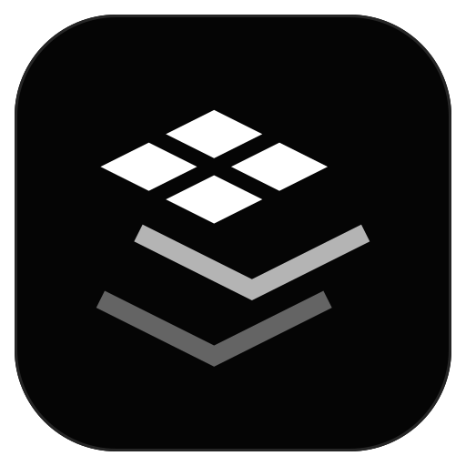
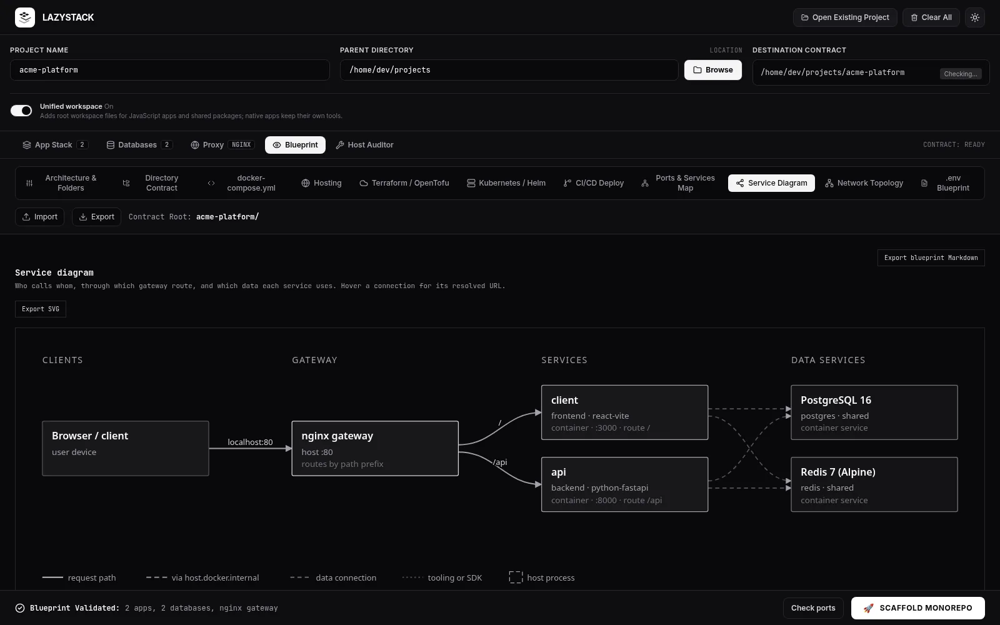
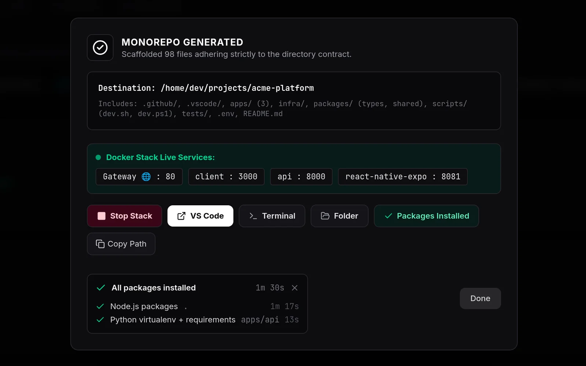

<p align="center">
  
</p>

<h1 align="center">LazyStack</h1>

<p align="center">
  Pick your frameworks, databases and layout. LazyStack writes the project:<br>
  native app folders, Docker Compose, <code>.env</code>, a reverse proxy and one command to run it all.
</p>

<p align="center">
  <a href="https://github.com/Ian-nwb/LazyStack/releases/latest"></a>
  <a href="https://github.com/Ian-nwb/LazyStack/actions/workflows/ci.yml"></a>
  <a href="https://www.npmjs.com/package/lazystack"></a>
  <a href="LICENSE"></a>
</p>

<p align="center">
  <a href="https://github.com/Ian-nwb/LazyStack/releases/latest"><b>Download</b></a> ·
  <a href="https://lazystack-showcase.vercel.app">Website</a> ·
  <a href="#cli">CLI</a> ·
  <a href="CHANGELOG.md">Changelog</a> ·
  <a href=".github/CONTRIBUTING.md">Contributing</a>
</p>


LazyStack is a desktop app and a command-line tool for starting polyglot projects. Combine a React client, a FastAPI service, a Go worker and an Expo app with PostgreSQL and Redis, choose an architecture layout, and get a project where every app follows its framework's own conventions and the whole stack starts with `npm run dev`.

**Current version: 1.5.2.** Hotfix: auto-install from the Host Auditor works again on Linux (it asks for your password through the desktop prompt instead of failing on `sudo`) and on Windows (winget no longer hangs on its agreement prompt, and installing no longer rewrites your PATH). 1.5.1 fixed installed tools showing as missing until Re-Audit Host. 1.5.0: Adds the Goose language (a plain Goose app and a Goose HTTP service), Dart Jaspr, and a host auditor that checks every toolchain the catalog needs, with Flutter and Dart now found when they're installed outside the default PATH. 1.4.0 added 6 databases and broker examples for Rust and ASP.NET. See the [changelog](CHANGELOG.md).

## Download

| Platform | Package |
| --- | --- |
| Linux x64 | [`LazyStack-1.5.2.AppImage`](https://github.com/Ian-nwb/LazyStack/releases/download/v1.5.2/LazyStack-1.5.2.AppImage) |
| Windows x64 | [`LazyStack.1.5.2.exe`](https://github.com/Ian-nwb/LazyStack/releases/download/v1.5.2/LazyStack.1.5.2.exe) (portable) |
| macOS |package not yet available (sponsor me a Macbook for app signature) |

The CLI is on npm: `npx lazystack --help`.

To run the projects LazyStack generates you need Docker with Compose, plus the toolchains of the frameworks you pick. The **Host Auditor** tab checks them and can install missing ones.

## What it does

- **118 frameworks across every role.** Frontends, backend services, full-stack apps, workers, desktop and mobile clients, and scripts, in JavaScript/TypeScript, Python, Go, Rust, Java, Kotlin, C#, PHP, Ruby, Elixir, Swift, Dart, Goose and a long tail of others. See the [full list](#supported-frameworks-databases-and-tools).
- **Framework-native starters.** Each app gets what its own initializer would create (`create-expo-app`, `nest new`, `django-admin startproject`, `mix phx.new`, `dx new`, `dotnet new maui`, start.spring.io, and so on), with a passing test, a `.gitignore` and a README.
- **32 databases and services.** PostgreSQL, MySQL, MongoDB, Redis, Kafka, NATS, CockroachDB, ClickHouse, Qdrant and more run in Compose with generated credentials; Supabase, Firebase, Neon, Turso and other cloud providers get SDK clients and environment variables. Optional admin UIs: Adminer, pgAdmin, Prisma Studio, phpMyAdmin, Mongo Express, Redis Commander.
- **15 architecture layouts.** Standard monorepo, microservices, modular monolith, Polyglot, event-driven, serverless, DDD, hexagonal, clean architecture, CQRS, JAMstack and edge, mobile and cross-platform, data platform, AI/ML, or your own folder structure. The Blueprint shows the exact resulting tree.
- **Port-conflict check.** Duplicate ports (including fixed extras such as RabbitMQ's management UI) block scaffolding; a live banner offers Auto-fix, and `lazystack ports` also reports ports already in use on your machine.
- **Service connections.** Wire apps together with URLs, environment variable names, health checks and startup order.
- **One command to run everything.** The generated dev orchestrator starts databases in Docker and every app on the host with hot reload and colour-coded output.
- **Deployment files.** Docker Compose, Nginx/Apache/Caddy/Traefik config, Kubernetes manifests, a Helm chart, Terraform for AWS/GCP/DigitalOcean and GitHub Actions workflows.
- **Existing projects.** Open a folder you already have: LazyStack detects its apps, databases and proxy, shows the stack as a diagram, and adds new services without touching your code.
- **Testing tools per app.** Jest, Vitest, pytest, JUnit, Playwright, Cypress, k6, Pact, Storybook, OWASP ZAP and more, opt-in per app.

<!-- catalog:start (generated by `npm run docs:catalog`; do not edit by hand) -->

## Supported frameworks, databases and tools

LazyStack ships **118 frameworks** in 32 languages, **45 databases and services**, 32 testing tools, 15 architecture layouts, 5 stack presets and 4 reverse proxies. Every framework below generates a framework-native starter with a Dockerfile, a test, a README and a `.gitignore`.

### Frameworks (118)

| Language | Frameworks and app types |
| --- | --- |
| JavaScript / TypeScript | Vanilla Node.js (http) (backend), Deno 2.0 (Native Server / Oak) (backend), Deno (Fresh Framework) (full-stack), Bun (ElysiaJS) (backend), Express (backend), Fastify (backend), NestJS (backend), Hono (backend), Next.js (App Router) (full-stack), Nuxt 3 (Vue Fullstack) (full-stack), Remix / React Router v7 (full-stack), SvelteKit (full-stack), Astro (Content & Islands) (full-stack), React 19 + Vite (frontend), React + MUI (Material UI) (frontend), Vue.js 3 + Vite (frontend), Angular 18+ (frontend), SolidJS + Vite (frontend), Qwik + Qwik City (frontend), Inferno (React-Compatible) (frontend), Ionic (Capacitor Mobile) (desktop/mobile), Capacitor (Web to Native) (desktop/mobile), Electron Desktop Client (desktop/mobile), React Native (Expo) (desktop/mobile), Google Apps Script (worker), AssemblyScript (Wasm) (worker), TanStack Start (React) (full-stack), SolidStart (full-stack), Lit (Web Components) (frontend), Quasar (Vite) (frontend), Svelte + Vite (frontend), Preact + Vite (frontend), Gatsby (frontend), Vike (React) (frontend), RedwoodJS (full-stack), Blitz.js (full-stack), Meteor (full-stack), Next.js + tRPC (full-stack), AdonisJS (backend), Koa (backend), Bun (Bun.serve) (backend), Eleventy (static site), Docusaurus (static site), VitePress (static site) |
| Python | Vanilla Python (WSGI) (backend), Python (FastAPI) (backend), Python (Django) (full-stack), Python (Flask) (backend), Reflex (Python Full-Stack UI) (full-stack), NiceGUI (Python Web UI) (full-stack), Anvil (Hosted Python Full-Stack) (full-stack), Python (Litestar) (backend), Python (Sanic) (backend), Python (Starlette) (backend), Python (Tornado) (backend), Python (Pyramid) (backend), Python (Streamlit) (full-stack), Python (Gradio) (full-stack) |
| Rust | Rust (Actix-Web) (backend), Rust (Axum) (backend), Rust (GPUI Desktop) (desktop/mobile), Rust (Dioxus) (frontend), Rust (Slint Desktop) (desktop/mobile), Rust (Bevy Game Engine) (desktop/mobile), Rust (Yew WebAssembly) (frontend), Rust (Leptos WebAssembly) (frontend), Tauri Desktop App (Rust + Web) (desktop/mobile), Rust (Poem OpenAPI) (backend) |
| Go | Vanilla Go (net/http) (backend), Go (Gin) (backend), Go (Fiber) (backend), Go (Echo) (backend), Go (Chi Router) (backend), Go (Goravel) (backend), Hugo (static site) |
| Dart | Dart (Flutter Web & Multiplatform) (desktop/mobile), Dart (Shelf) (backend), Dart (Serverpod) (backend), Dart (Jaspr) (full-stack) |
| Java | Vanilla Java (JDK HttpServer) (backend), Java (Spring Boot 3) (backend), Java (JavaFX Desktop) (desktop/mobile), Java (Swing Desktop) (desktop/mobile) |
| C# | C# (ASP.NET Core Web API) (backend), C# (Blazor Server/WASM) (full-stack), C# (.NET MAUI) (desktop/mobile) |
| PHP | Vanilla PHP (backend), PHP (Laravel 11) (full-stack), PHP (Symfony 7) (full-stack) |
| Goose | Goose (Vanilla) (worker), Goose (HTTP) (backend, experimental) |
| HTML / CSS / JS | Vanilla HTML5 / CSS3 / JS (frontend), HTMX + Modern Web (frontend) |
| Kotlin | Kotlin/JS Browser Frontend (frontend), Kotlin (Ktor / Spring Boot) (backend) |
| Ruby | Ruby (Ruby on Rails 7/8) (full-stack), Jekyll (static site) |
| Swift | SwiftUI Apple Client (desktop/mobile), Swift (Vapor 4) (backend) |
| Assembly | Assembly (x86_64 NASM) (backend, experimental) |
| Bash | Bash Shell Worker / CLI Service (worker) |
| C | C (libmicrohttpd / POSIX) (backend) |
| C++ | C++ (Drogon Framework) (backend) |
| Clojure | Clojure (Ring / Kit) (backend) |
| Crystal | Crystal (Kemal) (backend) |
| Elixir | Elixir (Phoenix LiveView) (backend) |
| Erlang | Erlang (Cowboy) (backend) |
| Gleam | Gleam (Wisp) (backend) |
| Haskell | Haskell (Scotty / Servant) (backend) |
| Julia | Julia (Genie.jl) (backend) |
| Lua | Lua (OpenResty / Lapis) (backend) |
| Nim | Nim (HappyX) (backend) |
| OCaml | OCaml (Dream) (backend) |
| R | R (Plumber API) (backend) |
| Scala | Scala (Play Framework) (backend) |
| SQL | SQL Migration & Seeder Service (worker) |
| V | V (veb) (backend) |
| Zig | Zig (HTTP / Zap) (backend) |

### Databases, brokers and cloud services (45)

Self-hosted ones run in Docker Compose with a healthcheck and generated credentials; cloud ones get an SDK client file and environment variables.

| Category | Services |
| --- | --- |
| Relational (SQL) | PostgreSQL 16, MySQL 8.4 LTS, MariaDB 11, ScyllaDB (Ultra-Fast Cassandra), CockroachDB (Distributed SQL) |
| Document | MongoDB 7, SurrealDB v2 |
| Key-value | DynamoDB Local |
| Cache | Redis 7 (Alpine), Valkey 8 (Linux Foundation), Memcached (Distributed Cache), Dragonfly (Redis-Compatible) |
| Analytics (OLAP) and time series | ClickHouse OLAP, InfluxDB 2 (Time Series), TimescaleDB (Postgres Time Series) |
| Graph | Neo4j Graph Database |
| Embedded | SQLite (Embedded / Shared File) |
| Vector | Qdrant Vector DB (AI & Embeddings), pgvector (Postgres + Vector Search) |
| Search | Meilisearch (Instant Full-Text), OpenSearch (Search & Analytics), Typesense (Typo-Tolerant Search), Elasticsearch 9 (Single Node) |
| Object storage | MinIO (S3-Compatible Object Store), SeaweedFS (S3-Compatible Storage) |
| Message brokers and streaming | RabbitMQ (Message Broker + GUI), Apache Kafka (Event Streaming / KRaft), Eclipse Mosquitto (MQTT Broker), Redpanda (Kafka API, no JVM), NATS (JetStream Messaging) |
| Auth and identity (OIDC) | Keycloak (OIDC / SSO) |
| Developer tools (email, AWS emulation) | Mailpit (Dev SMTP + Inbox), LocalStack (AWS Emulator) |
| Observability (OpenTelemetry) | Grafana LGTM (OpenTelemetry) |
| Local AI | Ollama (Local LLMs) |
| Workflows and durable jobs | Temporal (Durable Workflows) |
| Backend as a service (SDK client + env vars) | Supabase (Postgres + Auth + Realtime), Firebase (Firestore + Auth + Storage), Appwrite (Open-Source BaaS), Convex (Reactive Backend), Pocketbase (Single-Binary BaaS) |
| Managed cloud databases (SDK client + env vars) | PlanetScale (Serverless MySQL), Neon (Serverless Postgres), Turso (Edge SQLite / libSQL), Upstash (Serverless Redis + Kafka) |

### Database admin UIs

| Database | Admin UIs |
| --- | --- |
| PostgreSQL 16 | Adminer, pgAdmin, Prisma Studio |
| MySQL 8.4 LTS | Adminer, phpMyAdmin, Prisma Studio |
| MariaDB 11 | Adminer, phpMyAdmin, Prisma Studio |
| MongoDB 7 | Mongo Express |
| Redis 7 (Alpine) | Redis Commander |
| Valkey 8 (Linux Foundation) | Redis Commander |
| Apache Kafka (Event Streaming / KRaft) | Kafka UI |
| Redpanda (Kafka API, no JVM) | Kafka UI |
| NATS (JetStream Messaging) | NATS NUI |
| TimescaleDB (Postgres Time Series) | Adminer, pgAdmin |
| pgvector (Postgres + Vector Search) | Adminer, pgAdmin |
| Dragonfly (Redis-Compatible) | Redis Commander |

### Testing tools (32)

| Category | Tools |
| --- | --- |
| Unit & component | Jest, Vitest, Mocha, AVA, Node.js test runner, Testing Library, pytest, Hypothesis, Go test, Testify, Rust test harness, cargo-nextest, JUnit 5, xUnit, PHPUnit, Pest |
| API & integration | Supertest, Newman (Postman CLI), Bruno CLI, Swagger UI + OpenAPI (Redocly CLI), REST Assured, Schemathesis |
| Browser E2E | Playwright, Cypress, WebdriverIO, Puppeteer |
| Visual & component docs | Storybook |
| Performance | k6, Locust |
| Contract | Typed OpenAPI client (TypeScript), Pact |
| Security | OWASP ZAP baseline |

### Architecture layouts (15)

| Layout | Structure |
| --- | --- |
| Standard Monorepo | Apps in apps/, shared code in packages/ |
| Microservices Decoupled | One folder per service, per-service data stores |
| Domain-Driven Design (DDD) | Domains in domains/, shared kernel in core/ |
| Polyglot | Apps split by role into frontend/ and backend/ |
| Modular Monolith | Feature modules in modules/, shared libs in libs/ |
| Hexagonal / Ports & Adapters | Services plus a shared domain core and adapters |
| Serverless & Cloud-Native | Functions in functions/, web clients in web/ |
| Event-Driven Services | Services, consumers and typed event contracts |
| Data Platform | Pipelines, ingestion services and dashboards |
| AI / ML & LLM Platform | Models, agents, inference, evaluation and prompts |
| Clean Architecture / Onion | Services plus shared domain rules and use cases |
| CQRS & Event Sourcing | Command services, projections and event contracts |
| JAMstack & Edge Platform | Sites in sites/, edge functions in edge/ |
| Mobile & Cross-Platform Monorepo | Mobile, web and desktop apps with shared packages |
| Custom Structure | Your own directory contract |

### Stack presets (5)

One-click starting points, also available as `lazystack scaffold --preset <id>`.

| Preset | id | What you get |
| --- | --- | --- |
| T3 Next.js Stack | `t3-stack` | Next.js App Router with Postgres and Nginx Reverse Proxy |
| FastAPI + React Stack | `fastapi-react` | Async Python backend with React frontend & Redis cache |
| Modern MERN Stack | `modern-mern` | React TypeScript frontend with Express & MongoDB |
| Go Echo + Vue 3 | `go-vue` | Ultra-fast Go microservice with Vue 3 and Postgres |
| Rust Axum High-Perf | `rust-axum` | Type-safe memory-efficient Rust server with SolidJS & Valkey |

### Reverse proxies and deployment

- **Reverse proxies:** Nginx, Apache httpd, Caddy, Traefik (or none).
- **Deployment files:** Docker Compose (production and dev), Kubernetes manifests, a Helm chart, Terraform for AWS, GCP and DigitalOcean, and GitHub Actions workflows.
- **Workspace modes:** native-only (each app keeps only its own ecosystem files) or a unified pnpm + Turborepo workspace with shared `packages/types`.

<!-- catalog:end -->

## Screenshots

| | |
| --- | --- |
|  |  |
| **Framework picker.** Prerequisites are checked on your machine as you browse. | **Service diagram.** Apps, connections and the databases they use. |
|  |  |
| **Manual setup.** Steps LazyStack can't do for you, listed after scaffolding. | **Install Packages.** Every ecosystem's dependencies, with live progress. |

## CLI

The `lazystack` CLI uses the same generator as the desktop app.

```bash
npx lazystack init --preset fastapi-react --name my-api          # interactive or preset-based blueprint
npx lazystack scaffold --config lazystack.json --out ./projects  # --out is the parent directory
cd projects/my-api && npx lazystack dev                          # databases in Docker, apps on the host
```

| Command | What it does |
| --- | --- |
| `init` | Create a blueprint interactively or from a preset |
| `list`, `presets`, `search <term>` | Browse the catalog (`search --json` for scripts) |
| `validate`, `plan`, `doctor` | Check a blueprint, preview the services, check host toolchains |
| `export` | Write a preset as a blueprint you can edit |
| `scaffold` | Generate a project (`--dry-run` to preview, `--force` to update a non-empty folder) |
| `import`, `add`, `apply` | Read an existing project, add an app to it, or apply an edited blueprint (`--dry-run` supported) |
| `dev` | Start a generated project's stack (`--docker` to run everything in containers) |

## Generated projects

Every project includes a root README, `.env` and `.env.example`, Docker Compose files under the infrastructure folder, `scripts/dev-orchestrator.mjs`, and an embedded `lazystack.json` so it can be opened again later.

<details>
<summary><b>Dev orchestrator</b></summary>

`npm run dev` (or `lazystack dev`) in a generated project:

1. Starts the databases and brokers in Docker with `docker compose up -d`.
2. Runs every app on the host with its native command (`uvicorn`, `go run`, `cargo run`, `mvn spring-boot:run`, `npx expo start`, ...).
3. Prefixes each line of output with the app's name in its own colour.
4. Passes the root `.env` to every process.
5. Stops all child processes on Ctrl+C.

`npm run dev:docker` runs the whole stack in containers instead.
</details>

<details>
<summary><b>Event-driven wiring</b></summary>

When the stack includes RabbitMQ, Kafka (KRaft), Redis or Valkey, LazyStack adds `packages/events/` with typed event envelopes, a retry policy with exponential backoff and a dead-letter topic, plus publisher and consumer starters for Node.js, Python and Go.
</details>

<details>
<summary><b>Deployment output</b></summary>

- `infra/terraform/`: AWS ECS/Fargate modules, with GCP Cloud Run and DigitalOcean App Platform definitions ready to enable.
- `infra/k8s/`: a Deployment and Service per app, a ConfigMap, placeholder Secrets and an Ingress when a proxy is configured.
- `infra/helm/<project>/`: a Helm chart skeleton.
- `.github/workflows/`: `ci.yml` validates the Compose config; `deploy.yml` builds and pushes every service image to GHCR.
</details>

<details>
<summary><b>Architecture layouts</b></summary>

| Layout | Directory focus |
| --- | --- |
| Standard Monorepo | `apps/`, `packages/`, `infra/` |
| Microservices Decoupled | `services/`, `shared/contracts/`, isolated service data |
| Domain-Driven Design | `domains/`, `core/`, bounded contexts |
| Polyglot | `frontend/clients/`, `backend/services/`, `backend/workers/`, `deploy/` |
| Modular Monolith | `modules/`, `libs/`, shared deployment |
| Hexagonal / Ports & Adapters | `services/`, shared `core/` and `adapters/` |
| Serverless & Cloud-Native | `functions/`, `web/`, `shared/`, cloud infrastructure |
| Event-Driven Services | APIs, consumers, event schemas and broker infrastructure |
| Data Platform | Pipelines, ingestion services, dashboards and schemas |
| AI / ML & LLM Platform | `models/`, `agents/`, `services/inference/`, `prompts/` |
| Clean Architecture / Onion | `domain/`, `usecases/`, `adapters/`, `services/` |
| CQRS & Event Sourcing | `services/commands/`, `services/projections/`, `events/` |
| JAMstack & Edge Platform | `sites/`, `edge/workers/`, `edge/schedulers/`, `deploy/` |
| Mobile & Cross-Platform | `apps/mobile/`, `apps/web/`, `apps/desktop/`, `packages/ui/` |
| Custom Structure | Your own roots, folders and per-app paths |

Apps are placed inside the layout's root and then follow their framework's layout; see [framework layouts](docs/framework-layouts.md).
</details>

## Build from source

Requires Node.js 20+ and npm 10+.

```bash
git clone https://github.com/Ian-nwb/LazyStack.git
cd LazyStack
npm install
npm run dev            # browser UI with a local API
npm run build && npm start   # desktop app
```

Package the desktop app:

```bash
npm run dist:linux     # release/<version>/LazyStack-<version>.AppImage
npm run dist:win       # release/<version>/LazyStack <version>.exe (portable)
npm run dist:release   # both
```

## Repository layout

```text
electron/            Electron main process, scaffolding generator and templates
src/                 Desktop interface (React), shared catalogs and the CLI source
packages/cli/        The published lazystack npm package
scripts/             Template verifier used in CI
docs/                Framework layouts, release guides and release plans
showcase/            Project website
```

## Ideas under consideration

Not built yet: a local AI assistant that drafts blueprints from a description, separate development/staging/production profiles, OpenTelemetry and Grafana wiring, database backup and restore, Vault and 1Password integration, a shareable template registry, Pulumi export, and sizing estimates.

## Contributing

Bug reports, framework requests and pull requests are welcome. See [CONTRIBUTING](.github/CONTRIBUTING.md) for how the code is organised and how to check a change.

## License

[MIT](LICENSE) © Ian-nwb
