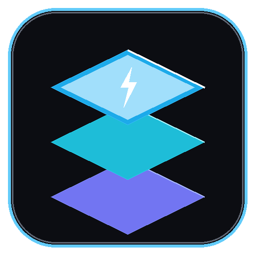
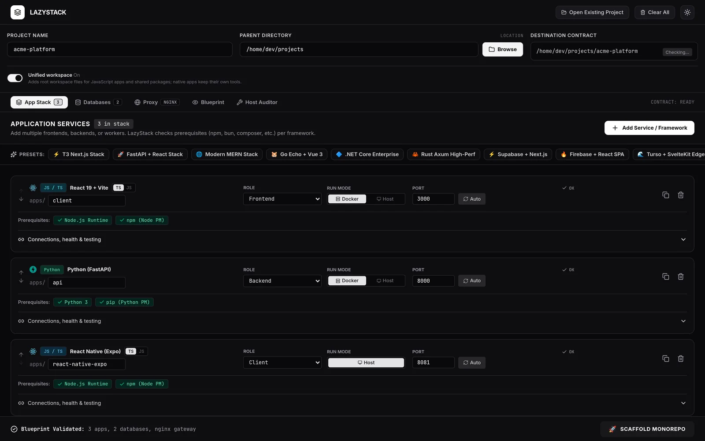
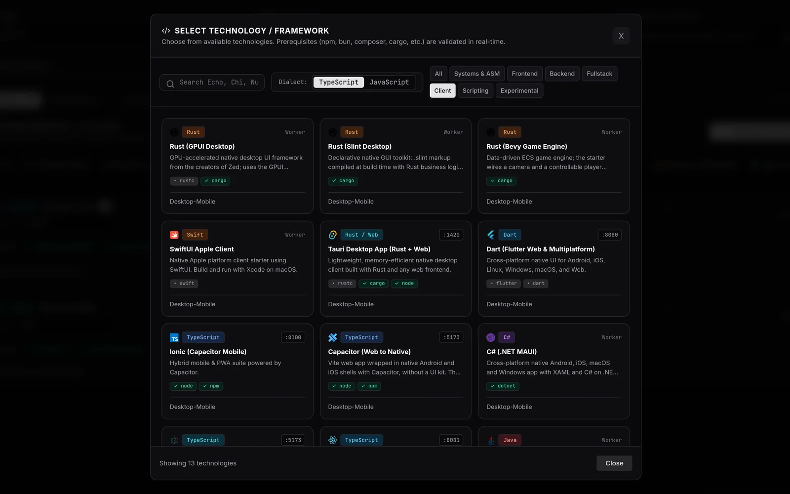
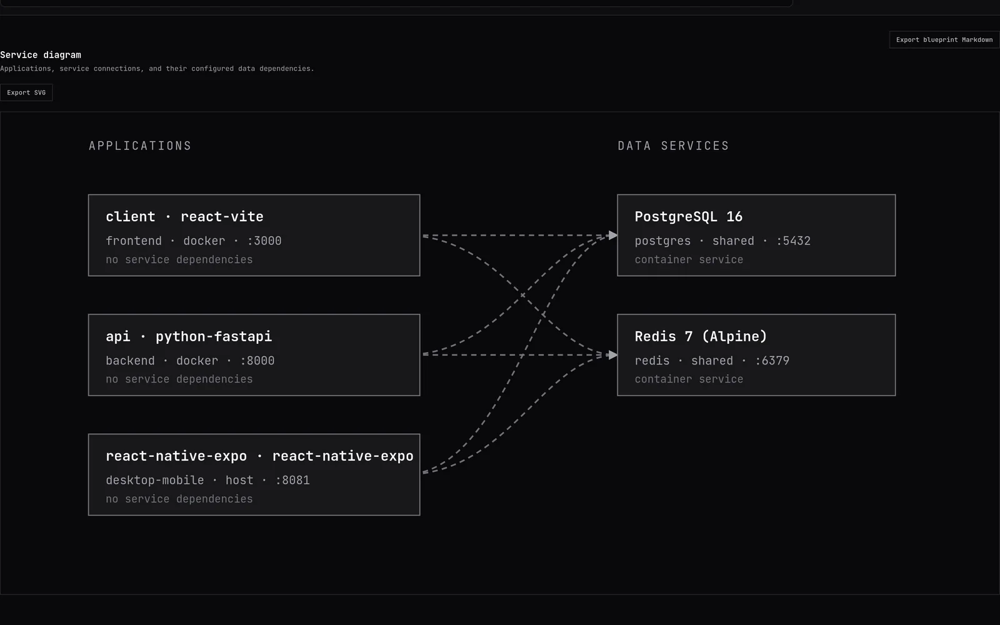
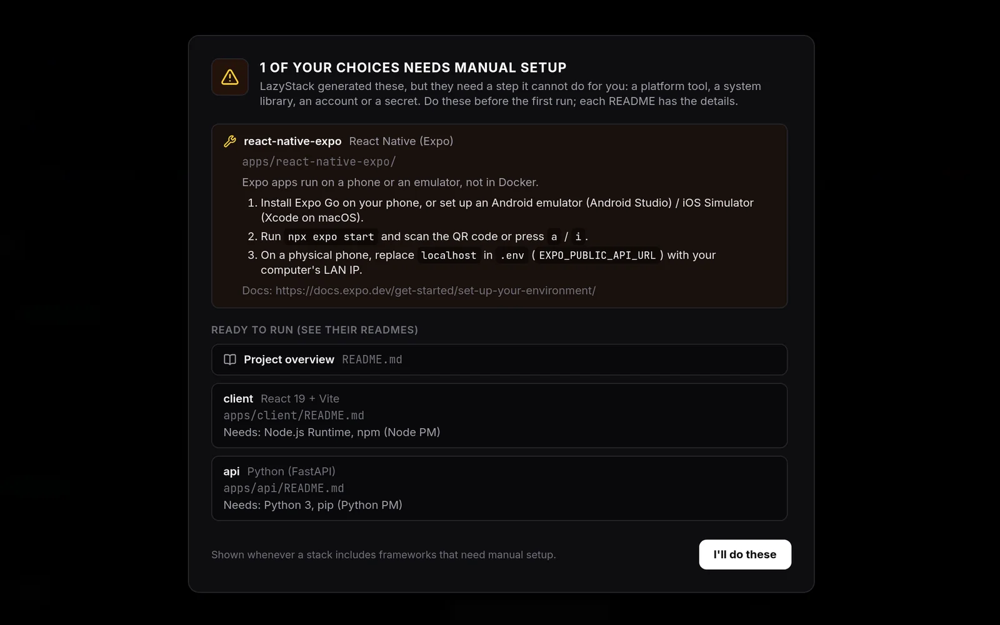
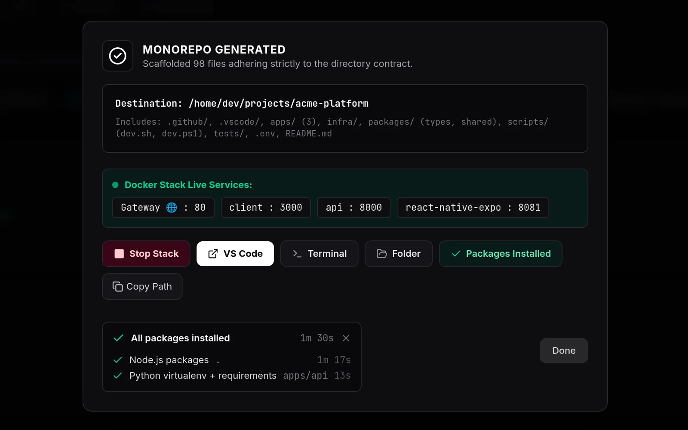

<p align="center">
  
</p>

<h1 align="center">LazyStack</h1>

<p align="center">
  Pick your frameworks, databases and layout. LazyStack writes the project:<br>
  native app folders, Docker Compose, <code>.env</code>, a reverse proxy and one command to run it all.
</p>

<p align="center">
  <a href="https://github.com/Ian-nwb/LazyStack/releases/latest"></a>
  <a href="https://github.com/Ian-nwb/LazyStack/actions/workflows/ci.yml"></a>
  <a href="https://www.npmjs.com/package/lazystack"></a>
  <a href="LICENSE"></a>
</p>

<p align="center">
  <a href="https://github.com/Ian-nwb/LazyStack/releases/latest"><b>Download</b></a> ·
  <a href="https://lazystack-showcase.vercel.app">Website</a> ·
  <a href="#cli">CLI</a> ·
  <a href="CHANGELOG.md">Changelog</a> ·
  <a href=".github/CONTRIBUTING.md">Contributing</a>
</p>



LazyStack is a desktop app and a command-line tool for starting polyglot projects. Combine a React client, a FastAPI service, a Go worker and an Expo app with PostgreSQL and Redis, choose an architecture layout, and get a project where every app follows its framework's own conventions and the whole stack starts with `npm run dev`.

**Current version: 1.3.0.** Added 28 frameworks (Svelte, Preact, Quasar, Gatsby, Vike, RedwoodJS, Blitz, Meteor, Next.js + tRPC, AdonisJS, Koa, Bun, Litestar, Sanic, Starlette, Tornado, Pyramid, Streamlit, Gradio, Hugo, Jekyll, Eleventy, Docusaurus, VitePress, Gleam, V, Dart Shelf, Serverpod), a new static-site role, a port-conflict check, and NATS. See the [changelog](CHANGELOG.md).

## Download

| Platform | Package |
| --- | --- |
| Linux x64 | [`LazyStack-1.3.0.AppImage`](https://github.com/Ian-nwb/LazyStack/releases/download/v1.3.0/LazyStack-1.3.0.AppImage) |
| Windows x64 | [`LazyStack.1.3.0.exe`](https://github.com/Ian-nwb/LazyStack/releases/download/v1.3.0/LazyStack.1.3.0.exe) (portable) |
| macOS |package not yet available (sponsor me a Macbook for app signature) |

The CLI is on npm: `npx lazystack --help`.

To run the projects LazyStack generates you need Docker with Compose, plus the toolchains of the frameworks you pick. The **Host Auditor** tab checks them and can install missing ones.

## What it does

- **115 frameworks across every role.** Frontends, backend services, full-stack apps, workers, desktop and mobile clients, and scripts, in JavaScript/TypeScript, Python, Go, Rust, Java, Kotlin, C#, PHP, Ruby, Elixir, Swift, Dart and a long tail of others.
- **Framework-native starters.** Each app gets what its own initializer would create (`create-expo-app`, `nest new`, `django-admin startproject`, `mix phx.new`, `dx new`, `dotnet new maui`, start.spring.io, and so on), with a passing test, a `.gitignore` and a README.
- **26 databases and services.** PostgreSQL, MySQL, MongoDB, Redis, Kafka, NATS, ClickHouse, Qdrant and more run in Compose with generated credentials; Supabase, Firebase, Neon, Turso and other cloud providers get SDK clients and environment variables. Optional admin UIs: Adminer, pgAdmin, Prisma Studio, phpMyAdmin, Mongo Express, Redis Commander.
- **15 architecture layouts.** Standard monorepo, microservices, modular monolith, Polyglot, event-driven, serverless, DDD, hexagonal, clean architecture, CQRS, JAMstack and edge, mobile and cross-platform, data platform, AI/ML, or your own folder structure. The Blueprint shows the exact resulting tree.
- **Port-conflict check.** Duplicate ports (including fixed extras such as RabbitMQ's management UI) block scaffolding; a live banner offers Auto-fix, and `lazystack ports` also reports ports already in use on your machine.
- **Service connections.** Wire apps together with URLs, environment variable names, health checks and startup order.
- **One command to run everything.** The generated dev orchestrator starts databases in Docker and every app on the host with hot reload and colour-coded output.
- **Deployment files.** Docker Compose, Nginx/Apache/Caddy/Traefik config, Kubernetes manifests, a Helm chart, Terraform for AWS/GCP/DigitalOcean and GitHub Actions workflows.
- **Existing projects.** Open a folder you already have: LazyStack detects its apps, databases and proxy, shows the stack as a diagram, and adds new services without touching your code.
- **Testing tools per app.** Jest, Vitest, pytest, JUnit, Playwright, Cypress, k6, Pact, Storybook, OWASP ZAP and more, opt-in per app.

## Screenshots

| | |
| --- | --- |
|  |  |
| **Framework picker.** Prerequisites are checked on your machine as you browse. | **Service diagram.** Apps, connections and the databases they use. |
|  |  |
| **Manual setup.** Steps LazyStack can't do for you, listed after scaffolding. | **Install Packages.** Every ecosystem's dependencies, with live progress. |

## CLI

The `lazystack` CLI uses the same generator as the desktop app.

```bash
npx lazystack init --preset fastapi-react --name my-api          # interactive or preset-based blueprint
npx lazystack scaffold --config lazystack.json --out ./projects  # --out is the parent directory
cd projects/my-api && npx lazystack dev                          # databases in Docker, apps on the host
```

| Command | What it does |
| --- | --- |
| `init` | Create a blueprint interactively or from a preset |
| `list`, `presets`, `search <term>` | Browse the catalog (`search --json` for scripts) |
| `validate`, `plan`, `doctor` | Check a blueprint, preview the services, check host toolchains |
| `export` | Write a preset as a blueprint you can edit |
| `scaffold` | Generate a project (`--dry-run` to preview, `--force` to update a non-empty folder) |
| `import`, `add`, `apply` | Read an existing project, add an app to it, or apply an edited blueprint (`--dry-run` supported) |
| `dev` | Start a generated project's stack (`--docker` to run everything in containers) |

## Generated projects

Every project includes a root README, `.env` and `.env.example`, Docker Compose files under the infrastructure folder, `scripts/dev-orchestrator.mjs`, and an embedded `lazystack.json` so it can be opened again later.

<details>
<summary><b>Dev orchestrator</b></summary>

`npm run dev` (or `lazystack dev`) in a generated project:

1. Starts the databases and brokers in Docker with `docker compose up -d`.
2. Runs every app on the host with its native command (`uvicorn`, `go run`, `cargo run`, `mvn spring-boot:run`, `npx expo start`, ...).
3. Prefixes each line of output with the app's name in its own colour.
4. Passes the root `.env` to every process.
5. Stops all child processes on Ctrl+C.

`npm run dev:docker` runs the whole stack in containers instead.
</details>

<details>
<summary><b>Event-driven wiring</b></summary>

When the stack includes RabbitMQ, Kafka (KRaft), Redis or Valkey, LazyStack adds `packages/events/` with typed event envelopes, a retry policy with exponential backoff and a dead-letter topic, plus publisher and consumer starters for Node.js, Python and Go.
</details>

<details>
<summary><b>Deployment output</b></summary>

- `infra/terraform/`: AWS ECS/Fargate modules, with GCP Cloud Run and DigitalOcean App Platform definitions ready to enable.
- `infra/k8s/`: a Deployment and Service per app, a ConfigMap, placeholder Secrets and an Ingress when a proxy is configured.
- `infra/helm/<project>/`: a Helm chart skeleton.
- `.github/workflows/`: `ci.yml` validates the Compose config; `deploy.yml` builds and pushes every service image to GHCR.
</details>

<details>
<summary><b>Architecture layouts</b></summary>

| Layout | Directory focus |
| --- | --- |
| Standard Monorepo | `apps/`, `packages/`, `infra/` |
| Microservices Decoupled | `services/`, `shared/contracts/`, isolated service data |
| Domain-Driven Design | `domains/`, `core/`, bounded contexts |
| Polyglot | `frontend/clients/`, `backend/services/`, `backend/workers/`, `deploy/` |
| Modular Monolith | `modules/`, `libs/`, shared deployment |
| Hexagonal / Ports & Adapters | `services/`, shared `core/` and `adapters/` |
| Serverless & Cloud-Native | `functions/`, `web/`, `shared/`, cloud infrastructure |
| Event-Driven Services | APIs, consumers, event schemas and broker infrastructure |
| Data Platform | Pipelines, ingestion services, dashboards and schemas |
| AI / ML & LLM Platform | `models/`, `agents/`, `services/inference/`, `prompts/` |
| Clean Architecture / Onion | `domain/`, `usecases/`, `adapters/`, `services/` |
| CQRS & Event Sourcing | `services/commands/`, `services/projections/`, `events/` |
| JAMstack & Edge Platform | `sites/`, `edge/workers/`, `edge/schedulers/`, `deploy/` |
| Mobile & Cross-Platform | `apps/mobile/`, `apps/web/`, `apps/desktop/`, `packages/ui/` |
| Custom Structure | Your own roots, folders and per-app paths |

Apps are placed inside the layout's root and then follow their framework's layout; see [framework layouts](docs/framework-layouts.md).
</details>

## Build from source

Requires Node.js 20+ and npm 10+.

```bash
git clone https://github.com/Ian-nwb/LazyStack.git
cd LazyStack
npm install
npm run dev            # browser UI with a local API
npm run build && npm start   # desktop app
```

Package the desktop app:

```bash
npm run dist:linux     # release/<version>/LazyStack-<version>.AppImage
npm run dist:win       # release/<version>/LazyStack <version>.exe (portable)
npm run dist:release   # both
```

## Repository layout

```text
electron/            Electron main process, scaffolding generator and templates
src/                 Desktop interface (React), shared catalogs and the CLI source
packages/cli/        The published lazystack npm package
scripts/             Template verifier used in CI
docs/                Framework layouts, release guides and release plans
showcase/            Project website
```

## Ideas under consideration

Not built yet: a local AI assistant that drafts blueprints from a description, separate development/staging/production profiles, OpenTelemetry and Grafana wiring, database backup and restore, Vault and 1Password integration, a shareable template registry, Pulumi export, and sizing estimates.

## Contributing

Bug reports, framework requests and pull requests are welcome. See [CONTRIBUTING](.github/CONTRIBUTING.md) for how the code is organised and how to check a change.

## License

[MIT](LICENSE) © Ian-nwb
