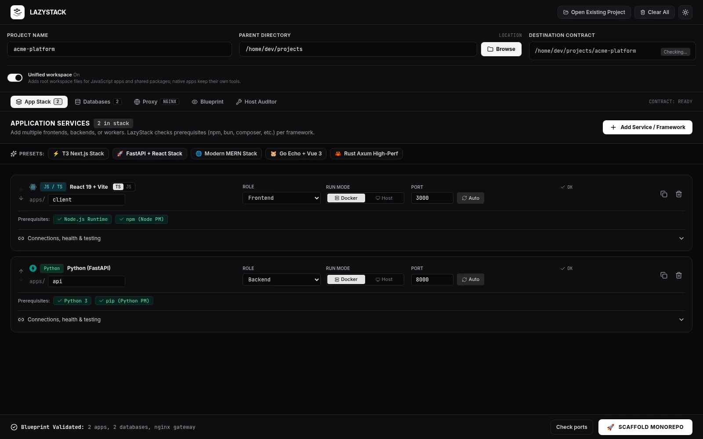
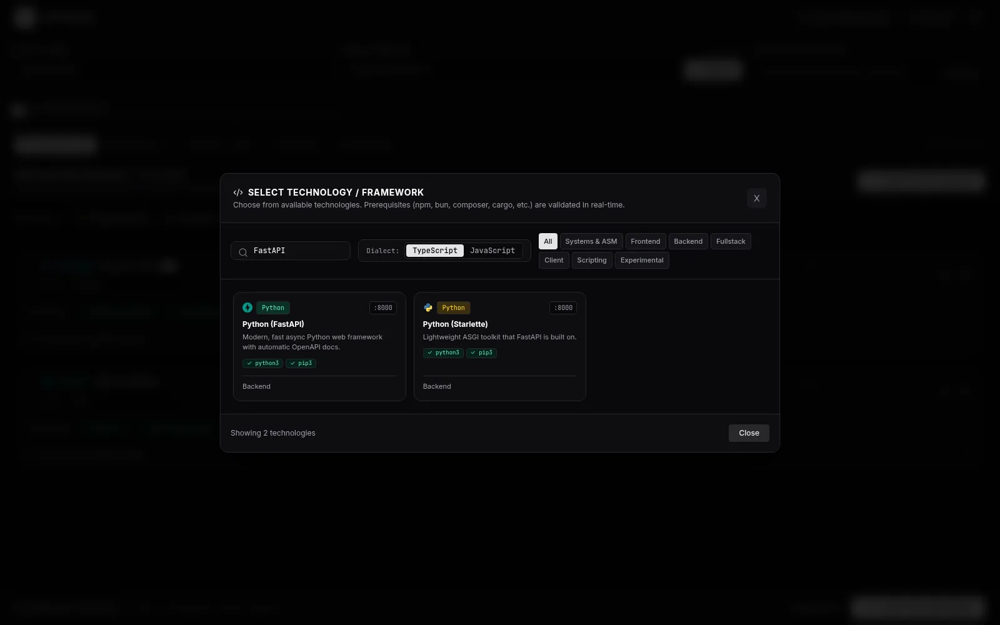
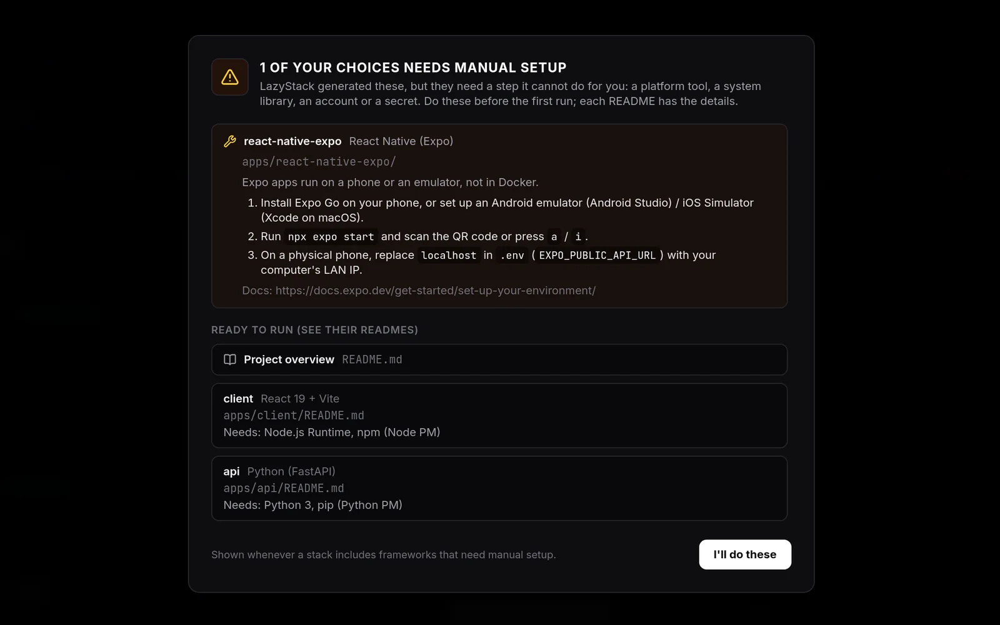

<p align="center">
  
</p>

<h1 align="center">LazyStack</h1>

<p align="center">
  Pick your frameworks, databases and layout. LazyStack writes the project:<br>
  native app folders, Docker Compose, <code>.env</code>, a reverse proxy and one command to run it all.
</p>

<p align="center">
  <a href="https://github.com/Ian-nwb/LazyStack/releases/latest"></a>
  <a href="https://github.com/Ian-nwb/LazyStack/actions/workflows/ci.yml"></a>
  <a href="https://www.npmjs.com/package/lazystack"></a>
  <a href="LICENSE"></a>
</p>

<p align="center">
  <a href="https://github.com/Ian-nwb/LazyStack/releases/latest"><b>Download</b></a> ·
  <a href="https://lazystack-showcase.vercel.app">Website</a> ·
  <a href="#user-guide">User guide</a> ·
  <a href="#cli">CLI</a> ·
  <a href="CHANGELOG.md">Changelog</a> ·
  <a href=".github/CONTRIBUTING.md">Contributing</a>
</p>



LazyStack is a desktop app and a command-line tool for starting polyglot projects. Combine a React client, a FastAPI service, a Go worker and an Expo app with PostgreSQL and Redis, choose an architecture layout, and get a project where every app follows its framework's own conventions and the whole stack starts with `npm run dev`.

**Current version: 2.1.0.** `lazystack dev` is now a dashboard that starts apps in dependency order once their dependencies are healthy, `lazystack upgrade` pulls template fixes into projects you already generated, a [hosting planner](#hosting-planner) suggests what kind of hosting each app needs, and LazyStack has a new logo. 2.0.1 made Docker builds fail when an app's build or dependency install fails (they used to produce an image that crashed at runtime), which also fixes the Ruby on Rails and Symfony images. 2.0.0 added 24 frameworks (F#, Elm and Perl are new languages; Quarkus, Micronaut, Go templ + HTMX, Django Ninja, React + Tailwind + shadcn/ui, Cloudflare Workers and more), 13 services (Keycloak, Mailpit, LocalStack, Grafana LGTM, Ollama, Temporal and others), a dev container, `mise.toml` and real deploy targets. See the [changelog](CHANGELOG.md).

## Download

| Platform | Package |
| --- | --- |
| Linux x64 | [`LazyStack-2.1.0.AppImage`](https://github.com/Ian-nwb/LazyStack/releases/download/v2.1.0/LazyStack-2.1.0.AppImage) |
| Windows x64 | [`LazyStack.2.1.0.exe`](https://github.com/Ian-nwb/LazyStack/releases/download/v2.1.0/LazyStack.2.1.0.exe) (portable) |
| macOS |package not yet available (sponsor me a Macbook for app signature) |

The CLI is on npm: `npx lazystack --help`.

To run the projects LazyStack generates you need Docker with Compose, plus the toolchains of the frameworks you pick. The **Host Auditor** tab checks them and can install missing ones.

## What it does

- **142 frameworks across every role.** Frontends, backend services, full-stack apps, workers, desktop and mobile clients, and scripts, in JavaScript/TypeScript, Python, Go, Rust, Java, Kotlin, C#, F#, PHP, Ruby, Elixir, Swift, Dart, Elm, Perl, Goose and a long tail of others. See the [full list](#supported-frameworks-databases-and-tools).
- **Framework-native starters.** Each app gets what its own initializer would create (`create-expo-app`, `nest new`, `django-admin startproject`, `mix phx.new`, `dx new`, `dotnet new maui`, start.spring.io, and so on), with a passing test, a `.gitignore` and a README.
- **45 databases and services.** PostgreSQL (plus TimescaleDB and pgvector), MySQL, MongoDB, Redis, Dragonfly, Kafka, NATS, CockroachDB, ClickHouse, Qdrant, Elasticsearch, Typesense and more run in Compose with generated credentials and healthchecks; Supabase, Firebase, Neon, Turso and other cloud providers get SDK clients and environment variables. Optional admin UIs: Adminer, pgAdmin, Prisma Studio, phpMyAdmin, Mongo Express, Redis Commander, Kafka UI, NATS NUI.
- **Developer services.** Keycloak (a realm with one OIDC client per app and a `dev`/`dev` user), Mailpit (catch-all SMTP with a web inbox), LocalStack and DynamoDB Local (AWS), Grafana LGTM (OpenTelemetry traces, logs and metrics), Ollama (local LLMs), SeaweedFS (S3) and Temporal (durable workflows), each wired into connected apps through well-known variables such as `OIDC_ISSUER_URL`, `SMTP_URL`, `AWS_ENDPOINT_URL` and `OTEL_EXPORTER_OTLP_ENDPOINT`.
- **15 architecture layouts.** Standard monorepo, microservices, modular monolith, Polyglot, event-driven, serverless, DDD, hexagonal, clean architecture, CQRS, JAMstack and edge, mobile and cross-platform, data platform, AI/ML, or your own folder structure. The Blueprint shows the exact resulting tree.
- **Port-conflict check.** Duplicate ports (including fixed extras such as RabbitMQ's management UI) block scaffolding; a live banner offers Auto-fix, and `lazystack ports` also reports ports already in use on your machine.
- **Service connections.** Wire apps together with URLs, environment variable names, health checks and startup order.
- **One command to run everything.** `npm run dev` (or `lazystack dev`) starts the databases in Docker, then every app on the host in dependency order, each one once the apps it calls answer their health check. In a terminal it's a dashboard: one row per service with its health, a log pane you can filter, restart with one key, and which `.env` variable points where.
- **Deployment files.** Docker Compose, Nginx/Apache/Caddy/Traefik config, Kubernetes manifests, a Helm chart, Terraform for AWS/GCP/DigitalOcean, a GitHub Actions workflow that builds images and deploys over SSH with Compose, a `fly.toml` per service, a Render Blueprint and GitLab CI.
- **Hosting planner.** Suggests what kind of hosting each app needs (static/CDN, serverless, BaaS, PaaS, self-hosted PaaS, managed containers, Kubernetes, cloud VM, VPS or bare metal) from its role and connections, shows example services for each, and lets you choose. Apps stay **local only** until you do. The choice is saved in the Blueprint, written to `docs/hosting.md`, and printed by `lazystack hosting`. See [Hosting planner](#hosting-planner).
- **Reproducible toolchains.** Every project gets `mise.toml` (run `mise install` to get the exact Node, Python, Go, Java, .NET, Rust... versions, no root needed) and a `.devcontainer` for VS Code and Codespaces, plus `.editorconfig`, Lefthook pre-commit formatters and Renovate.
- **Template upgrades.** `lazystack upgrade` brings fixes from a newer LazyStack into a project you already generated with a three-way merge: files you never touched update, your edits are kept, overlapping changes get standard conflict markers, and every changed file is backed up first.
- **Existing projects.** Open a folder you already have: LazyStack detects its apps, databases and proxy, shows the stack as a diagram, and adds new services without touching your code.
- **Testing tools per app.** Jest, Vitest, pytest, JUnit, Playwright, Cypress, k6, Pact, Storybook, OWASP ZAP and more, opt-in per app.

## Hosting planner

The Blueprint's **Hosting** tab (and `lazystack hosting`) suggests what kind of hosting each app needs, from its role, framework and connections, and lists the alternatives with example services and the LazyStack files that apply. Every app is **local only** until you choose a type: the project runs on your machine with the dev orchestrator and Compose. The planner is advice only. It never adds or changes deploy files; it points to the ones LazyStack already generates. Your choice is saved as `hosting` on the app in `lazystack.json` and written to `docs/hosting.md` in the generated project.

| Type | What it is | Good for | Watch out for | Examples | Upkeep | LazyStack files |
| --- | --- | --- | --- | --- | --- | --- |
| Local only (default) | Runs on your machine; not deployed | Development, demos, personal and LAN-only tools | Not reachable from the internet; stops when your machine does | Docker Compose, `lazystack dev` | none | dev orchestrator, Compose, `.env` |
| Static / CDN | Built files served from a global CDN, no server | SPAs, docs, marketing sites, static Astro/SvelteKit/Vite builds | Can't run server code; APIs live elsewhere | Cloudflare Pages, Netlify, GitHub Pages, S3 + CloudFront | none | – |
| Serverless | Functions per request, scale to zero | SSR apps, light APIs, webhooks, spiky or low traffic | Cold starts, time limits, no long-lived connections, usage-based bills | Cloudflare Workers, Vercel, Netlify Functions, AWS Lambda, Google Cloud Functions, Azure Functions | none | – |
| BaaS | A hosted backend (auth, database, storage, functions) you call from the client | Apps whose backend is mostly CRUD + auth; mobile and frontend-only teams | Lock-in to the provider's APIs; custom logic squeezed into their functions | Supabase, Firebase, Appwrite Cloud, PocketBase (hosted), Convex | none | cloud service clients, `.env` |
| PaaS | Push code or a Dockerfile; the platform runs and scales it | Full-stack apps, APIs with a database, getting started fast | Always-on services bill when idle; managed databases cost extra | Railway, Render, Fly.io, Heroku, DigitalOcean App Platform, Koyeb | low | `fly.toml`, `render.yaml`, Terraform (DigitalOcean App Platform), Dockerfiles |
| Self-hosted PaaS | PaaS-style git-push deploys running on your own server | Heroku-like workflow at VPS prices, many small apps on one box | You still own the server underneath | Coolify, Dokku, CapRover, Kamal | medium | Compose, Dockerfiles |
| Managed containers | Your Docker image on a managed runtime, no cluster to run | Docker apps, polyglot stacks, scale-to-zero containers | More config than a PaaS | Google Cloud Run, AWS App Runner, AWS ECS Fargate, Azure Container Apps | low | Dockerfiles, Terraform (AWS ECS, GCP Cloud Run) |
| Kubernetes | Managed cluster running your containers | Many services, autoscaling, teams already on K8s | Steep learning curve, cluster cost even when idle | GKE, EKS, AKS, DigitalOcean Kubernetes, Linode LKE | high | K8s manifests, Helm chart |
| Cloud VM | A virtual machine from a hyperscaler, inside its network and IAM | Workloads that need the rest of AWS/GCP/Azure (private networking, managed DBs, IAM), compliance, reserved/spot pricing | Pricier than a VPS for the same size; egress and extras billed separately; you manage the OS | AWS EC2, Google Compute Engine, Azure Virtual Machines, Oracle Cloud | high | Compose, GitHub Actions SSH deploy, proxy config |
| VPS | A simple virtual server at a flat monthly price | Lowest steady cost, full control, whole stack + DB on one box via Compose | You handle updates, backups, TLS, monitoring | Hetzner, DigitalOcean Droplets, Linode, Vultr, AWS Lightsail | high | Compose, proxy config, GitHub Actions SSH deploy |
| Bare metal | A dedicated physical server (rented or your own/on-prem) | Heavy steady load, GPUs, data that must stay on your hardware | Hardware failures, no instant scaling, most upkeep of all | Hetzner dedicated, OVHcloud, Latitude.sh, your own homelab or on-prem servers | high | Compose, proxy config |

**VPS vs cloud VM.** A VPS is a flat-priced box from a simple host; a cloud VM lives inside AWS/GCP/Azure with their networking, IAM and managed services, and bills per resource.

**How it decides.** The first rule that matches wins.

| # | When | Suggests | Alternatives |
| --- | --- | --- | --- |
| 1 | Desktop, mobile or other on-device app | Not hosted | – |
| 2 | Static site, or a frontend that builds to static files (Vite SPAs, Angular, Elm, Yew, Gatsby...) | Static / CDN | BaaS (when the stack's only backend is Supabase, Firebase, Appwrite...), PaaS, VPS |
| 3 | Worker, or an app connected to a broker or workflow engine (Kafka, NATS, RabbitMQ, Temporal...) | PaaS | Managed containers, VPS, cloud VM |
| 4 | Full-stack or server-rendered app | Serverless when the framework has an adapter (Next.js, Nuxt, SvelteKit, Astro, Remix...), otherwise PaaS | PaaS or managed containers, self-hosted PaaS |
| 5 | Backend connected to a database | PaaS | VPS, cloud VM, managed containers |
| 6 | Any other app with a Dockerfile | Managed containers (serverless for Hono and Cloudflare Workers) | PaaS, Kubernetes, VPS |
| 7 | Anything else | PaaS | VPS, cloud VM |

The planner also adds stack-level notes: a VPS with the generated Compose files when there's more than one app or any database, Kubernetes once there are four or more server apps, and the generated Terraform if you're already on AWS or GCP.

**Before you pick:**

- Free tiers can be personal-use only, or go offline when credits run out.
- Usage billing can overshoot: set spending alerts or caps.
- Databases are usually a separate bill.
- Cloud VMs and hyperscaler services charge for egress (data leaving their network).
- PaaS, serverless and BaaS manage the servers for you; VPS, cloud VM and bare metal are yours to maintain.

Prices and free tiers change often; check the provider's pricing page before you commit.

Based on Flavio Copes's [Where to host your app](https://flaviocopes.com/where-to-host/).

<!-- catalog:start (generated by `npm run docs:catalog`; do not edit by hand) -->

## Supported frameworks, databases and tools

LazyStack ships **142 frameworks** in 35 languages, **45 databases and services**, 32 testing tools, 15 architecture layouts, 5 stack presets and 4 reverse proxies. Every framework below generates a framework-native starter with a Dockerfile, a test, a README and a `.gitignore`.

### Frameworks (142)

| Language | Frameworks and app types |
| --- | --- |
| JavaScript / TypeScript | Vanilla Node.js (http) (backend), Deno 2.0 (Native Server / Oak) (backend), Deno (Fresh Framework) (full-stack), Bun (ElysiaJS) (backend), Express (backend), Fastify (backend), NestJS (backend), Hono (backend), Next.js (App Router) (full-stack), Nuxt 3 (Vue Fullstack) (full-stack), Remix / React Router v7 (full-stack), SvelteKit (full-stack), Astro (Content & Islands) (full-stack), React 19 + Vite (frontend), React + MUI (Material UI) (frontend), Vue.js 3 + Vite (frontend), Angular 18+ (frontend), SolidJS + Vite (frontend), Qwik + Qwik City (frontend), Inferno (React-Compatible) (frontend), Ionic (Capacitor Mobile) (desktop/mobile), Capacitor (Web to Native) (desktop/mobile), Electron Desktop Client (desktop/mobile), React Native (Expo) (desktop/mobile), Google Apps Script (worker), AssemblyScript (Wasm) (worker), TanStack Start (React) (full-stack), SolidStart (full-stack), Lit (Web Components) (frontend), Quasar (Vite) (frontend), Svelte + Vite (frontend), Preact + Vite (frontend), Gatsby (frontend), Vike (React) (frontend), RedwoodJS (full-stack), Blitz.js (full-stack), Meteor (full-stack), Next.js + tRPC (full-stack), AdonisJS (backend), Koa (backend), Bun (Bun.serve) (backend), Eleventy (static site), Docusaurus (static site), VitePress (static site), Alpine.js + Vite (frontend), React + Tailwind + shadcn/ui (frontend), Astro Starlight (Docs) (static site), Cloudflare Workers (Hono) (backend), Browser Extension (WXT) (desktop/mobile) |
| Python | Vanilla Python (WSGI) (backend), Python (FastAPI) (backend), Python (Django) (full-stack), Python (Flask) (backend), Reflex (Python Full-Stack UI) (full-stack), NiceGUI (Python Web UI) (full-stack), Anvil (Hosted Python Full-Stack) (full-stack), Python (Litestar) (backend), Python (Sanic) (backend), Python (Starlette) (backend), Python (Tornado) (backend), Python (Pyramid) (backend), Python (Streamlit) (full-stack), Python (Gradio) (full-stack), Python (Django Ninja) (backend), Python (Plotly Dash) (full-stack), Python (FastHTML) (full-stack), MkDocs Material (static site) |
| Rust | Rust (Actix-Web) (backend), Rust (Axum) (backend), Rust (GPUI Desktop) (desktop/mobile), Rust (Dioxus) (frontend), Rust (Slint Desktop) (desktop/mobile), Rust (Bevy Game Engine) (desktop/mobile), Rust (Yew WebAssembly) (frontend), Rust (Leptos WebAssembly) (frontend), Tauri Desktop App (Rust + Web) (desktop/mobile), Rust (Poem OpenAPI) (backend), Rust (Rocket) (backend) |
| Go | Vanilla Go (net/http) (backend), Go (Gin) (backend), Go (Fiber) (backend), Go (Echo) (backend), Go (Chi Router) (backend), Go (Goravel) (backend), Hugo (static site), Go (templ + HTMX) (full-stack) |
| Java | Vanilla Java (JDK HttpServer) (backend), Java (Spring Boot 3) (backend), Java (JavaFX Desktop) (desktop/mobile), Java (Swing Desktop) (desktop/mobile), Java (Quarkus) (backend), Java (Micronaut) (backend), Java (Javalin) (backend) |
| Dart | Dart (Flutter Web & Multiplatform) (desktop/mobile), Dart (Shelf) (backend), Dart (Serverpod) (backend), Dart (Jaspr) (full-stack), Dart (Dart Frog) (backend) |
| PHP | Vanilla PHP (backend), PHP (Laravel 11) (full-stack), PHP (Symfony 7) (full-stack), PHP (Slim 4) (backend), WordPress (full-stack) |
| C# | C# (ASP.NET Core Web API) (backend), C# (Blazor Server/WASM) (full-stack), C# (.NET MAUI) (desktop/mobile), C# (Razor Pages) (full-stack) |
| Ruby | Ruby (Ruby on Rails 7/8) (full-stack), Jekyll (static site), Ruby (Sinatra) (backend) |
| Swift | SwiftUI Apple Client (desktop/mobile), Swift (Vapor 4) (backend), Swift (Hummingbird 2) (backend) |
| Goose | Goose (Vanilla) (worker), Goose (HTTP) (backend, experimental) |
| HTML / CSS / JS | Vanilla HTML5 / CSS3 / JS (frontend), HTMX + Modern Web (frontend) |
| Kotlin | Kotlin/JS Browser Frontend (frontend), Kotlin (Ktor / Spring Boot) (backend) |
| R | R (Plumber API) (backend), R (Shiny) (full-stack) |
| Assembly | Assembly (x86_64 NASM) (backend, experimental) |
| Bash | Bash Shell Worker / CLI Service (worker) |
| C | C (libmicrohttpd / POSIX) (backend) |
| C++ | C++ (Drogon Framework) (backend) |
| Clojure | Clojure (Ring / Kit) (backend) |
| Crystal | Crystal (Kemal) (backend) |
| Elixir | Elixir (Phoenix LiveView) (backend) |
| Elm | Elm (Browser.element) (frontend) |
| Erlang | Erlang (Cowboy) (backend) |
| F# | F# (Giraffe) (backend) |
| Gleam | Gleam (Wisp) (backend) |
| Haskell | Haskell (Scotty / Servant) (backend) |
| Julia | Julia (Genie.jl) (backend) |
| Lua | Lua (OpenResty / Lapis) (backend) |
| Nim | Nim (HappyX) (backend) |
| OCaml | OCaml (Dream) (backend) |
| Perl | Perl (Mojolicious) (backend) |
| Scala | Scala (Play Framework) (backend) |
| SQL | SQL Migration & Seeder Service (worker) |
| V | V (veb) (backend) |
| Zig | Zig (HTTP / Zap) (backend) |

### Databases, brokers and cloud services (45)

Self-hosted ones run in Docker Compose with a healthcheck and generated credentials; cloud ones get an SDK client file and environment variables.

| Category | Services |
| --- | --- |
| Relational (SQL) | PostgreSQL 16, MySQL 8.4 LTS, MariaDB 11, ScyllaDB (Ultra-Fast Cassandra), CockroachDB (Distributed SQL) |
| Document | MongoDB 7, SurrealDB v2 |
| Key-value | DynamoDB Local |
| Cache | Redis 7 (Alpine), Valkey 8 (Linux Foundation), Memcached (Distributed Cache), Dragonfly (Redis-Compatible) |
| Analytics (OLAP) and time series | ClickHouse OLAP, InfluxDB 2 (Time Series), TimescaleDB (Postgres Time Series) |
| Graph | Neo4j Graph Database |
| Embedded | SQLite (Embedded / Shared File) |
| Vector | Qdrant Vector DB (AI & Embeddings), pgvector (Postgres + Vector Search) |
| Search | Meilisearch (Instant Full-Text), OpenSearch (Search & Analytics), Typesense (Typo-Tolerant Search), Elasticsearch 9 (Single Node) |
| Object storage | MinIO (S3-Compatible Object Store), SeaweedFS (S3-Compatible Storage) |
| Message brokers and streaming | RabbitMQ (Message Broker + GUI), Apache Kafka (Event Streaming / KRaft), Eclipse Mosquitto (MQTT Broker), Redpanda (Kafka API, no JVM), NATS (JetStream Messaging) |
| Auth and identity (OIDC) | Keycloak (OIDC / SSO) |
| Developer tools (email, AWS emulation) | Mailpit (Dev SMTP + Inbox), LocalStack (AWS Emulator) |
| Observability (OpenTelemetry) | Grafana LGTM (OpenTelemetry) |
| Local AI | Ollama (Local LLMs) |
| Workflows and durable jobs | Temporal (Durable Workflows) |
| Backend as a service (SDK client + env vars) | Supabase (Postgres + Auth + Realtime), Firebase (Firestore + Auth + Storage), Appwrite (Open-Source BaaS), Convex (Reactive Backend), Pocketbase (Single-Binary BaaS) |
| Managed cloud databases (SDK client + env vars) | PlanetScale (Serverless MySQL), Neon (Serverless Postgres), Turso (Edge SQLite / libSQL), Upstash (Serverless Redis + Kafka) |

### Database admin UIs

| Database | Admin UIs |
| --- | --- |
| PostgreSQL 16 | Adminer, pgAdmin, Prisma Studio |
| MySQL 8.4 LTS | Adminer, phpMyAdmin, Prisma Studio |
| MariaDB 11 | Adminer, phpMyAdmin, Prisma Studio |
| MongoDB 7 | Mongo Express |
| Redis 7 (Alpine) | Redis Commander |
| Valkey 8 (Linux Foundation) | Redis Commander |
| Apache Kafka (Event Streaming / KRaft) | Kafka UI |
| Redpanda (Kafka API, no JVM) | Kafka UI |
| NATS (JetStream Messaging) | NATS NUI |
| TimescaleDB (Postgres Time Series) | Adminer, pgAdmin |
| pgvector (Postgres + Vector Search) | Adminer, pgAdmin |
| Dragonfly (Redis-Compatible) | Redis Commander |

### Testing tools (32)

| Category | Tools |
| --- | --- |
| Unit & component | Jest, Vitest, Mocha, AVA, Node.js test runner, Testing Library, pytest, Hypothesis, Go test, Testify, Rust test harness, cargo-nextest, JUnit 5, xUnit, PHPUnit, Pest |
| API & integration | Supertest, Newman (Postman CLI), Bruno CLI, Swagger UI + OpenAPI (Redocly CLI), REST Assured, Schemathesis |
| Browser E2E | Playwright, Cypress, WebdriverIO, Puppeteer |
| Visual & component docs | Storybook |
| Performance | k6, Locust |
| Contract | Typed OpenAPI client (TypeScript), Pact |
| Security | OWASP ZAP baseline |

### Architecture layouts (15)

| Layout | Structure |
| --- | --- |
| Standard Monorepo | Apps in apps/, shared code in packages/ |
| Microservices Decoupled | One folder per service, per-service data stores |
| Domain-Driven Design (DDD) | Domains in domains/, shared kernel in core/ |
| Polyglot | Apps split by role into frontend/ and backend/ |
| Modular Monolith | Feature modules in modules/, shared libs in libs/ |
| Hexagonal / Ports & Adapters | Services plus a shared domain core and adapters |
| Serverless & Cloud-Native | Functions in functions/, web clients in web/ |
| Event-Driven Services | Services, consumers and typed event contracts |
| Data Platform | Pipelines, ingestion services and dashboards |
| AI / ML & LLM Platform | Models, agents, inference, evaluation and prompts |
| Clean Architecture / Onion | Services plus shared domain rules and use cases |
| CQRS & Event Sourcing | Command services, projections and event contracts |
| JAMstack & Edge Platform | Sites in sites/, edge functions in edge/ |
| Mobile & Cross-Platform Monorepo | Mobile, web and desktop apps with shared packages |
| Custom Structure | Your own directory contract |

### Stack presets (5)

One-click starting points, also available as `lazystack scaffold --preset <id>`.

| Preset | id | What you get |
| --- | --- | --- |
| T3 Next.js Stack | `t3-stack` | Next.js App Router with Postgres and Nginx Reverse Proxy |
| FastAPI + React Stack | `fastapi-react` | Async Python backend with React frontend & Redis cache |
| Modern MERN Stack | `modern-mern` | React TypeScript frontend with Express & MongoDB |
| Go Echo + Vue 3 | `go-vue` | Ultra-fast Go microservice with Vue 3 and Postgres |
| Rust Axum High-Perf | `rust-axum` | Type-safe memory-efficient Rust server with SolidJS & Valkey |

### Reverse proxies and deployment

- **Reverse proxies:** Nginx, Apache httpd, Caddy, Traefik (or none).
- **Deployment files:** Docker Compose (production and dev), Kubernetes manifests, a Helm chart, Terraform for AWS, GCP and DigitalOcean, and GitHub Actions workflows.
- **Workspace modes:** native-only (each app keeps only its own ecosystem files) or a unified pnpm + Turborepo workspace with shared `packages/types`.

<!-- catalog:end -->

## Screenshots

| | |
| --- | --- |
|  |  |
| **Framework picker.** Prerequisites are checked on your machine as you browse. | **Service diagram.** Apps, connections and the databases they use. |
|  |  |
| **Manual setup.** Steps LazyStack can't do for you, listed after scaffolding. | **Install Packages.** Every ecosystem's dependencies, with live progress. |

## User guide

This guide walks through the whole workflow: install, design a stack, generate it, run it, choose hosting, change it later, upgrade it and deploy it. Each step works in the desktop app and in the CLI.

### 1. Install

- **Desktop app:** download the AppImage (Linux) or the portable `.exe` (Windows) from [Download](#download). Nothing else is needed to design and generate projects.
- **CLI:** `npx lazystack help` (Node.js 22+). Install it globally with `npm install -g lazystack` if you use it often.
- **To run generated projects** you need Docker (for databases and services) and the toolchains of the frameworks you pick (Node.js, Python, Go, Rust, the JDK, .NET...). The **Host Auditor** tab and `lazystack doctor` show what's missing and how to install it. Every project also gets a `mise.toml` (`mise install` fetches the exact versions) and a dev container.

### 2. Design a stack (desktop app)

1. **Project name and parent directory** at the top. The destination folder is `<parent>/<name>`.
2. **App Stack:** start from a preset (T3, FastAPI + React, MERN, Go + Vue, Rust + Axum) or add frameworks from the catalog. For each app, set its folder name, port and run mode (Docker or host). Open **Service options** to add:
   - **connections** to other apps (an environment variable such as `API_URL` with the target's URL; the target starts first),
   - a **health check** (HTTP path or command), used by Compose and by the dev dashboard,
   - **testing tools** (Jest, pytest, Playwright, k6, Pact...),
   - a **starter profile** where one exists (for example FastAPI's API service with CRUD, auth and migrations).
3. **Databases:** add self-hosted databases, brokers and developer services (they run in Compose with generated credentials) or cloud providers (SDK clients and env vars). Set each one's scope (global or one app) and an optional admin UI.
4. **Proxy:** Nginx, Apache, Caddy, Traefik or none, and the route prefix for each app.
5. **Blueprint:** check the result before anything is written: the architecture layout and folders, the exact file tree, Compose, Terraform, Kubernetes, CI/CD, ports, diagrams, `.env`, and **Hosting** (see step 5). **Export** saves the whole design as a `lazystack.json` blueprint; **Import** loads one.
6. The bar at the bottom lists problems (such as duplicate ports, with **Auto-fix ports**). **Check ports** also finds ports already in use on your machine. **Scaffold Monorepo** writes the project.

After scaffolding, the app shows each app's manual first-run steps (if any) and buttons to open the folder, VS Code or a terminal, **Install Packages** for every ecosystem, and **Start Stack (Docker)**.

### 3. Design a stack (CLI)

```bash
npx lazystack init --preset fastapi-react --name shop          # writes ./lazystack.json
# edit lazystack.json: apps, databases, connections, healthCheck, hosting...
npx lazystack validate -c lazystack.json                       # catches mistakes without writing files
npx lazystack plan -c lazystack.json                           # services and the folder tree
npx lazystack doctor -c lazystack.json                         # toolchains this stack needs
npx lazystack ports -c lazystack.json                          # duplicates and ports busy on this machine
npx lazystack scaffold -c lazystack.json --out ~/projects      # --out is the parent folder
```

`lazystack search <term>`, `list` and `presets` browse the catalog.

### 4. Run it

```bash
cd ~/projects/shop
lazystack dev          # or: npm run dev (unified workspace), ./scripts/dev.sh, .\scripts\dev.ps1
```

Databases start in Docker and wait until they're healthy; then the apps start on the host, each one after the apps it depends on. In the dashboard, press `2` to see the second app's logs, `/` to filter (for example `error`), `e` to see which environment variable points where, `r` to restart the selected app (or all of them from row `0`), and `q` to stop. Use `lazystack dev --plain` for plain logs, and `lazystack dev --docker` to run the whole stack in containers instead.

Each app also has its own README with its native commands (`uvicorn`, `go run`, `cargo run`...).

### 5. Choose hosting

Every app is **local only** until you choose where it runs. The Blueprint **Hosting** tab and `lazystack hosting -c lazystack.json` show a suggestion per app (static/CDN, serverless, PaaS, managed containers...) with the reason, alternatives, example services and the generated files to use. Pick a type in the tab or set `"hosting": "paas"` on the app in `lazystack.json`. The choice is written to `docs/hosting.md`. See [Hosting planner](#hosting-planner).

### 6. Change a project you already have

- **Desktop:** **Open Existing Project** reads the folder (its `lazystack.json`, or detects frameworks, Compose databases and the proxy). Edit the stack, then **Review & Apply Changes** shows every file that will be created or regenerated before anything is written.
- **CLI:**

  ```bash
  lazystack import --dir ./shop                                 # what LazyStack sees
  lazystack add --dir ./shop --tech go-gin --name billing --dry-run
  lazystack import --dir ./shop --out edited.json               # edit it, then:
  lazystack apply --dir ./shop --config edited.json --dry-run
  ```

Your app code is never overwritten: new files are created, `.env` files only gain missing keys, and regenerated files (Compose, proxy config, dev orchestrator, `docs/hosting.md`, `lazystack.json`) are copied to `.lazystack/backup/<timestamp>/` first.

### 7. Upgrade to a newer LazyStack

When a LazyStack release fixes a template (a Dockerfile, a workflow, a starter), pull the fix into your project:

```bash
git commit -am "before upgrade"        # upgrade refuses to run on uncommitted changes
lazystack upgrade --dir ./shop --dry-run
lazystack upgrade --dir ./shop
git diff                               # review; search for <<<<<<< yours if it reported conflicts
```

It renders your blueprint with the version that generated the project (fetched from npm with `npx lazystack@<version>`) and with the current version, then merges each file three ways: files you never changed take the new template, your own edits are kept, and changes on both sides are merged, with standard conflict markers where they overlap. `.env` files only gain missing keys. Projects made before 2.1.0 don't record their version: add `--from 2.0.0` (or the version you used).

### 8. Deploy

Generated projects include Compose files, Kubernetes manifests, a Helm chart, Terraform (AWS ECS, GCP Cloud Run, DigitalOcean App Platform), `fly.toml` per app, a Render Blueprint, GitLab CI, and a GitHub Actions workflow that pushes images to GHCR and, when you set the `DEPLOY_HOST` variable, deploys over SSH with Compose. The hosting planner tells you which of these to use for each app.

### 9. Troubleshooting

| Problem | What to do |
| --- | --- |
| A port is already in use | `lazystack ports -c lazystack.json`, or **Check ports** / **Auto-fix ports** in the app |
| A toolchain is missing | **Host Auditor** tab (install from there) or `lazystack doctor` |
| An app shows ✕ failed in the dashboard | Select it to read its logs; install its dependencies (see its README), then press `r` |
| Docker isn't running | The dashboard says so and starts the apps anyway; start Docker and restart them |
| Upgrade reported conflicts | Edit the files with `<<<<<<< yours` markers, keep what you want, and commit |
| You want an old file back | Every regenerated or upgraded file is in `.lazystack/backup/<timestamp>/` |

### 10. Files LazyStack keeps in your project

- `lazystack.json`: the blueprint (apps, databases, connections, layout, hosting) plus `$lazystack` (format) and `$generator` (the LazyStack version that generated or last upgraded the project). Edit it and run `lazystack apply` to change the project.
- `.lazystack/backup/`: copies of files LazyStack replaced (ignored by git).
- `scripts/dev-orchestrator.mjs`: the dev dashboard. Its `CONFIG` block is regenerated when the blueprint changes.
- `docs/architecture.md` and `docs/hosting.md`: diagrams and the hosting plan.

## CLI

The `lazystack` CLI uses the same generator as the desktop app.

```bash
npx lazystack init --preset fastapi-react --name my-api          # interactive or preset-based blueprint
npx lazystack scaffold --config lazystack.json --out ./projects  # --out is the parent directory
cd projects/my-api && npx lazystack dev                          # databases in Docker, apps on the host
```

| Command | What it does |
| --- | --- |
| `init` | Create a blueprint interactively or from a preset |
| `list`, `presets`, `search <term>` | Browse the catalog (`search --json` for scripts) |
| `validate`, `plan`, `doctor` | Check a blueprint, preview the services, check host toolchains |
| `hosting` | Suggest hosting per app and show the saved choice (`--types` compares all types, `--json` for scripts) |
| `export` | Write a preset as a blueprint you can edit |
| `scaffold` | Generate a project (`--dry-run` to preview, `--force` to update a non-empty folder) |
| `import`, `add`, `apply` | Read an existing project, add an app to it, or apply an edited blueprint (`--dry-run` supported) |
| `dev` | Start a generated project's stack with the dashboard (`--plain` for plain logs, `--docker` to run everything in containers) |
| `upgrade` | Pull template fixes from this version into a generated project (`--dry-run`, `--from <version>` for projects made before 2.1.0) |

## Generated projects

Every project includes a root README, `.env` and `.env.example`, Docker Compose files under the infrastructure folder, `scripts/dev-orchestrator.mjs`, `docs/architecture.md`, `docs/hosting.md` (the hosting plan, refreshed whenever the blueprint is applied again), and an embedded `lazystack.json` so it can be opened again later.

<details>
<summary><b>Dev orchestrator</b></summary>

`npm run dev` (or `lazystack dev`) in a generated project:

1. Starts the databases, brokers and other services in Docker (`docker compose up -d --wait`) and waits for their healthchecks. App containers and the gateway are not started; in dev the apps run on the host.
2. Runs first-boot migrations (Django, Laravel, Prisma).
3. Starts every app on the host with its native command (`uvicorn`, `go run`, `cargo run`, `mvn spring-boot:run`, `npx expo start`, ...) in dependency order: an app waits until the apps it connects to answer their health check (the HTTP path you set, or the port accepting connections).
4. Shows a dashboard in a terminal: one row per service (○ waiting, ◐ starting, ● healthy, ▲ unhealthy, ✕ failed), the logs of all apps or one app, and the environment wiring. Keys: `↑`/`↓` or `0`–`9` select, `/` filter the logs, `e` environment variables, `r` restart, `c` clear, `q` quit.
5. Prints plain, colour-prefixed logs instead when the output isn't a terminal, in CI, or with `--plain`.
6. Passes the root `.env` to every process and stops every app (and what it spawned) on `q` or Ctrl+C. The databases keep running.

`npm run dev:docker` runs the whole stack in containers instead.
</details>

<details>
<summary><b>Event-driven wiring</b></summary>

When the stack includes RabbitMQ, Kafka (KRaft), Redis or Valkey, LazyStack adds `packages/events/` with typed event envelopes, a retry policy with exponential backoff and a dead-letter topic, plus publisher and consumer starters for Node.js, Python and Go.
</details>

<details>
<summary><b>Deployment output</b></summary>

- `infra/terraform/`: AWS ECS/Fargate modules, with GCP Cloud Run and DigitalOcean App Platform definitions ready to enable.
- `infra/k8s/`: a Deployment and Service per app, a ConfigMap, placeholder Secrets and an Ingress when a proxy is configured.
- `infra/helm/<project>/`: a Helm chart skeleton.
- `.github/workflows/`: `ci.yml` validates the Compose config; `deploy.yml` builds and pushes every service image to GHCR.
</details>

<details>
<summary><b>Architecture layouts</b></summary>

| Layout | Directory focus |
| --- | --- |
| Standard Monorepo | `apps/`, `packages/`, `infra/` |
| Microservices Decoupled | `services/`, `shared/contracts/`, isolated service data |
| Domain-Driven Design | `domains/`, `core/`, bounded contexts |
| Polyglot | `frontend/clients/`, `backend/services/`, `backend/workers/`, `deploy/` |
| Modular Monolith | `modules/`, `libs/`, shared deployment |
| Hexagonal / Ports & Adapters | `services/`, shared `core/` and `adapters/` |
| Serverless & Cloud-Native | `functions/`, `web/`, `shared/`, cloud infrastructure |
| Event-Driven Services | APIs, consumers, event schemas and broker infrastructure |
| Data Platform | Pipelines, ingestion services, dashboards and schemas |
| AI / ML & LLM Platform | `models/`, `agents/`, `services/inference/`, `prompts/` |
| Clean Architecture / Onion | `domain/`, `usecases/`, `adapters/`, `services/` |
| CQRS & Event Sourcing | `services/commands/`, `services/projections/`, `events/` |
| JAMstack & Edge Platform | `sites/`, `edge/workers/`, `edge/schedulers/`, `deploy/` |
| Mobile & Cross-Platform | `apps/mobile/`, `apps/web/`, `apps/desktop/`, `packages/ui/` |
| Custom Structure | Your own roots, folders and per-app paths |

Apps are placed inside the layout's root and then follow their framework's layout; see [framework layouts](docs/framework-layouts.md).
</details>

## Build from source

Requires Node.js 22+ and npm 10+.

```bash
git clone https://github.com/Ian-nwb/LazyStack.git
cd LazyStack
npm install
npm run dev            # browser UI with a local API
npm run build && npm start   # desktop app
```

Package the desktop app:

```bash
npm run dist:linux     # release/<version>/LazyStack-<version>.AppImage
npm run dist:win       # release/<version>/LazyStack.<version>.exe (portable)
npm run dist:release   # Linux + Windows
```

Pushing a `v*` tag runs `.github/workflows/release.yml`, which builds both on GitHub's runners, creates the GitHub release from `CHANGELOG.md` and publishes the CLI to npm.

Checks:

```bash
npx tsc --noEmit
npm run test:unit         # installer helpers and generator invariants (no Docker)
npm run verify:templates  # starter files vs Dockerfiles for every framework
npm run check:images      # every image the generator can emit still exists
scripts/build-starter.sh go-templ-htmx   # scaffold one framework and docker build it
```

`.github/workflows/starters.yml` builds every starter and checks every image weekly.

## Repository layout

```text
electron/            Electron main process, scaffolding generator and templates
src/                 Desktop interface (React), shared catalogs and the CLI source
packages/cli/        The published lazystack npm package
scripts/             Template verifier used in CI
docs/                Framework layouts, release guides and release plans
showcase/            Project website
```

## Ideas under consideration

See [ROADMAP.md](ROADMAP.md). 2.x: `lazystack upgrade` (three-way template merges), environment profiles and secrets, a `lazystack dev` dashboard and per-PR preview environments. 3.0: boot and stack tests for every starter, services wired into app code (OIDC, OpenTelemetry), templates as files and community template packs. Catalog additions under consideration: ClojureScript, ReScript, PureScript, Scala.js and Compose Multiplatform; Analog, Waku, Ember, Nitro, Encore.ts, Loco.rs, Vaadin, Laravel + Inertia/Livewire and headless CMSs (Payload, Strapi, Directus, Medusa); per-app ORM and UI-kit choices; gRPC/GraphQL/AsyncAPI codegen; Zitadel and Authentik; environment profiles, secrets (Vault, 1Password), a template registry, an AI blueprint drafter, Pulumi export, and a macOS build (sponsor me a Macbook for app signature).

## Contributing

Bug reports, framework requests and pull requests are welcome. See [CONTRIBUTING](.github/CONTRIBUTING.md) for how the code is organised and how to check a change.

## License

[MIT](LICENSE) © Ian-nwb
